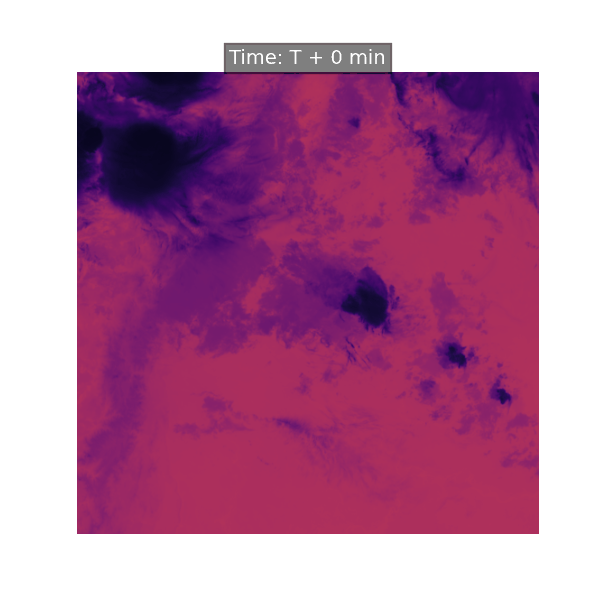
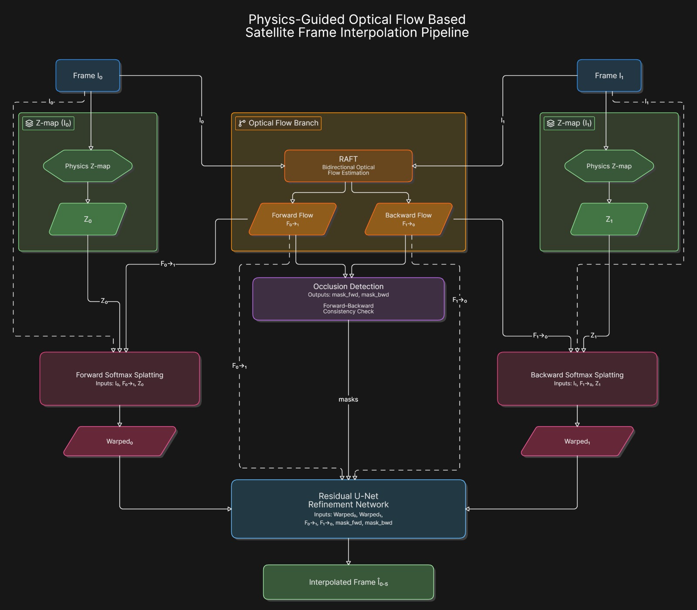
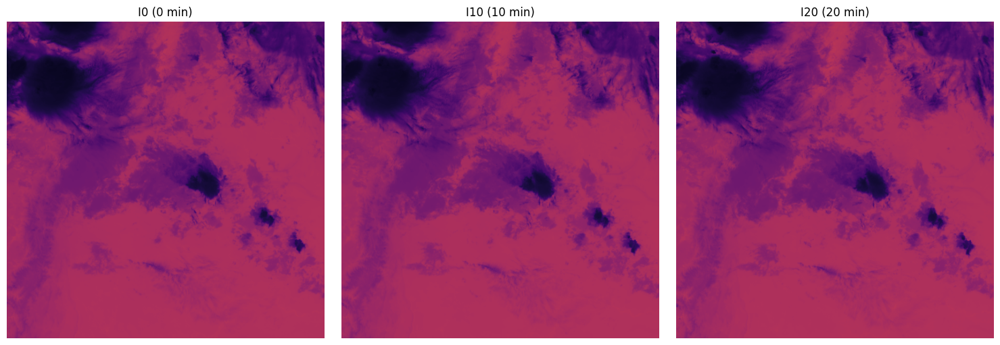
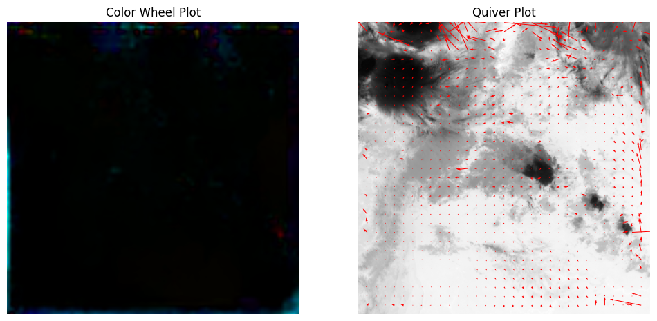
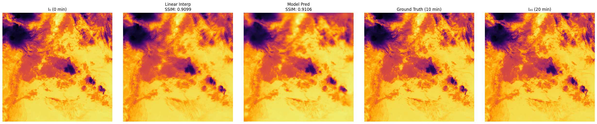
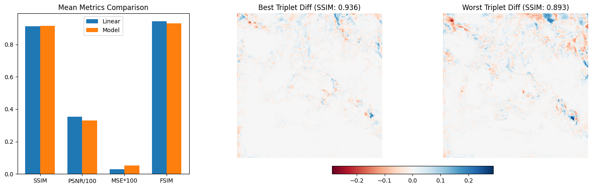

# GOES-19 Satellite Frame Interpolation

**Self-supervised neural frame interpolation for geostationary thermal-IR satellite imagery.**
Given two scans from the NOAA GOES-19 ABI imager taken **30 and 60 minutes apart** (Channel 13, clean thermal IR), the pipeline synthesizes the missing **midpoint frame** — useful for smooth cloud-motion animation, storm tracking and gap-free nowcasting loops.

```
I0 (t=0)  ─────────────?>  I30 (t=30 min)  <────────────?  I60 (t=60 min)
              RAFT flow + physics Z-map + softmax splatting + U-Net
```

**Demo — animated interpolation between the two endpoint scans (intermediate steps are model-generated):**



> Developed in Google Colab during a hackathon sprint; the final Colab notebook
> was distilled into this modular package (prototype kept in `notebooks/`).

---

## How it works

The model is trained **self-supervised** on real satellite data — no labels needed.
At training time the real 30-minute frame supervises the reconstruction; at
inference only the two endpoint frames are required.

**Pipeline components**

| Stage | Component | Role |
|---|---|---|
| Flow | `SatelliteRAFT` (torchvision RAFT-small) | Bidirectional optical flow I0→I60, I60→I0 (Farneback CPU fallback) |
| Occlusion | Forward-backward consistency check | Mask trustworthy pixels; mark holes red in diagnostics |
| Physics | `PhysicsZMapNet` | Z = (1 − radiance) + CNN residual: colder, taller cloud tops get stronger splat weight |
| Warping | Bidirectional **softmax splatting** (sniklaus CUDA kernel, pure-PyTorch fallback) | Forward-splats both endpoints to the midpoint, z-weighted and occlusion-aware |
| Synthesis | U-Net (ResNet34 encoder, 8-channel input, `segmentation-models-pytorch`) | Predicts a **residual** correction: `pred = clamp(blend + (unet − 0.5), 0, 1)` so an untrained net can't regress below the geometric baseline |
| Loss | Composite `0.2·L1 + 0.8·(1−SSIM)` (piq) | SSIM-dominant objective for structural realism |
| Training | AMP + AdamW + cosine annealing + grad clipping | Efficient on Colab GPUs |

**Architecture**



---

## Results

Measured on a validation run over GOES-19 ABI Channel 13 triplets
(26 train / 6 val triplets, self-supervised, no ground-truth labels used at inference):

| Metric | Value |
|---|---|
| Best validation SSIM | **0.936** |
| Best validation PSNR | **34.7 dB** |
| Mean SSIM (model vs linear) | 0.913 vs 0.913 (Δ +0.000) |

At a 10-min midpoint cadence the atmosphere barely moves between frames, so plain
linear blending is already a strong baseline — the model holds SSIM parity while
also delivering occlusion-aware warping (hole handling via splatting + consistency
masks). The packaged CLI defaults to **30-min gaps**, the regime where linear
interpolation visibly degrades and learned warping earns its keep.

---

## Visual walkthrough

**Input triplet — GOES-19 Channel 13 thermal IR (I0 / I10 / I20)**



**RAFT optical flow — color wheel (hue = direction, saturation = magnitude) and quiver plot**



**Interpolation outcome — linear vs model vs ground truth (10-min gap)**



**Benchmark — mean metrics and per-triplet best/worst error maps**



---

## Quickstart

```bash
# PyTorch: install per your platform (https://pytorch.org/get-started/)
pip install -r requirements.txt

# Full pipeline: data -> diagnostics -> training -> benchmark
python main.py --stage all

# Or stage by stage
python main.py --stage download --triplets 16 --hours 24
python main.py --stage explore
python main.py --stage train --epochs 30
python main.py --stage eval
```

Runs on CPU, but GPU is strongly recommended (RAFT + training).

### Outputs (all in `outputs/`)

| File | Contents |
|---|---|
| `01_triplet_preview.png` | I0 / I30 / I60 triplet |
| `02_optical_flow.png` | Color-wheel + quiver plot of RAFT flow |
| `03_occlusion_masks.png` | Forward/backward occlusion masks and holes |
| `04_physics_zmap.png` | Z prior and refined Z map |
| `05_softmax_splatting.png` | Splatted frames with holes in red |
| `06_training_loss_curve.png` | Composite loss over epochs |
| `07_interpolation_comparison.png` | Linear vs model vs ground truth |
| `08_benchmark.png` | Metric bars + diff maps + zoom crops |
| `interpolated_sequence.gif` | Animated 0→15→30→45→60 min sequence |
| `results.json` / `report.txt` | Machine-readable metrics / summary |

---

## Project structure

```
satellite/
├── main.py                     # CLI entrypoint orchestrating all stages
├── requirements.txt
├── docs/
│   ├── architecture.png        # pipeline architecture diagram
│   └── results/                # figures from a full validation run
│       ├── interpolated_sequence.gif
│       ├── triplet_preview.png
│       ├── optical_flow.png
│       ├── interpolation_comparison.png
│       └── benchmark.png
├── goes_interp/
│   ├── config.py               # paths, data + training hyperparameters
│   ├── utils.py                # seeding, device helpers, tensor utils
│   ├── setup_splatting.py      # sniklaus softmax-splatting CUDA setup + fallback
│   ├── data/
│   │   ├── download.py         # S3 triplet discovery (30-min stride) + download
│   │   ├── loaders.py          # .nc radiance loading, NaN fill, normalize
│   │   └── dataset.py          # PyTorch Dataset over triplets
│   ├── models/
│   │   ├── raft.py             # RAFT-small optical flow (+ Farneback fallback)
│   │   ├── warp.py             # grid_sample backward warp + occlusion masks
│   │   ├── zmap.py             # physics-guided Z-map CNN
│   │   ├── splat.py            # bidirectional softmax splatting
│   │   └── unet.py             # U-Net synthesis + composite loss
│   ├── train.py                # self-supervised training loop
│   ├── inference.py            # checkpoint loading + `interpolate()`
│   ├── evaluate.py             # SSIM/PSNR/MSE/FSIM benchmark vs linear
│   ├── visualize.py            # all figure/report generation
│   └── demo.py                 # single-triplet diagnostics + GIF export
└── notebooks/
    └── legacy_notebook_isro2.py  # original Colab prototype (superseded)
```

---

## Data & acknowledgements

- **Data:** NOAA GOES-19 ABI-L1b-RadF open bucket `noaa-goes19` on AWS S3 (public, anonymous access).
- **Softmax splatting:** [sniklaus/softmax-splatting](https://github.com/sniklaus/softmax-splatting)
- **RAFT:** torchvision `raft_small` (pretrained weights)
- **U-Net:** [segmentation-models-pytorch](https://github.com/qubvel/segmentation_models.pytorch)
- **Metrics:** [piq](https://github.com/photosynthesis-team/piq)

## Roadmap

- Multi-channel input (eyes/chilled-cloud composites) for sharper cloud edges
- Temporal consistency loss across consecutive t
- Larger search window + multi-day training sets for scale
- ONNX/FP16 export for deployment
